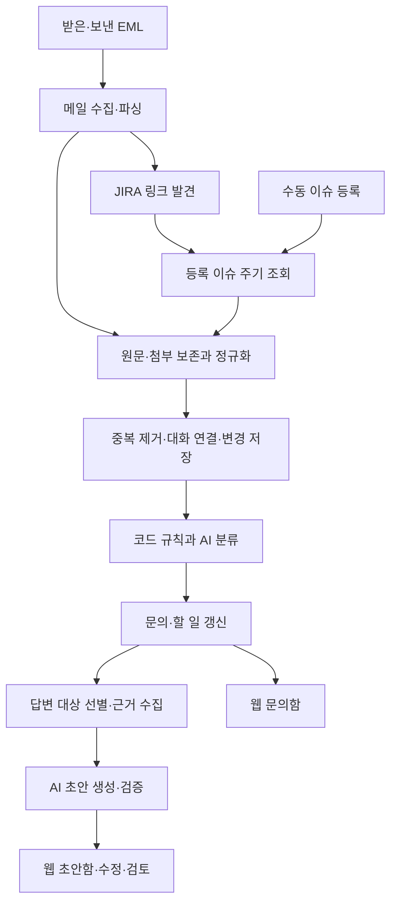

# WorkTrail Windows·업무일지 통합 실행 계획 (2026-11-14 갱신)

이 개정 범위는 기존 구현을 확인한 뒤 확장한 0.3입니다. 아래 1.0 신규 개발 계획은 0.2의 설계 이력으로 보존합니다. 기존 P0~P6를 처음부터 반복하지 않습니다. "기존 코드 미확인", "업무일지 범위 제외", "브라우저 전용" 및 미체크 완료 목록은 과거 기준이며 현재 범위는 이 절과 [Windows 운영 안내](windows-worktrail.md), [진행 기록](progress.md)을 우선합니다.

| 순서 | 구현 내용 | 검증 방법 |
|---|---|---|
| W1 | Windows Python venv, UTF-8, subprocess/프로세스 종료, 기존 core 재사용 | 기존 45 tests WSL/Windows 기준 비교 |
| W2 | pywebview/WebView2 + localhost 백엔드 + 독립 worker, 사용자 데이터 경로, 중복 실행 잠금 | Windows EXE 실행·화면 DOM·재기동·데이터 유지 |
| W3 | Inquiry/Action/Draft 확장, projects/activities/evidence/편집 이력, 수동 기록 | schema v5 migration snapshot·version 충돌·백업 복원 |
| W4 | 기존 공통 classify 트랜잭션의 performed 제안 재사용, 수신/발신/대기/수행 연결 | 약속은 수행 아님, 확인한 수행·action 완료, 재분류 편집본 보존 |
| W5 | 날짜/프로젝트별 코드 집계, Markdown 생성 영역 보존, 명시 파일 가져오기 | 반복 export 동일성·사용자 메모 보존·생성본 재입력 거부 |
| W6 | Windows onedir EXE, 로그인 세션 COM adapter와 timeout 복구, 사내 이식 안내 | fake/EML·COM timeout 중 API 유지·worker kill/lease 복구 |

실제 사내 DRM/Outlook·Office 버전/계정/JIRA/모델 정확도/장기 운영은 현장 미검증입니다. 교차 출처 의미 중복은 사용자 대표 기록 지정으로 확정하며, 추측으로 자동 병합하지 않습니다. 기존 worklog 위치는 제공되지 않았으므로 일괄 변환 구조는 실제 자료 확인 후 추가합니다. 집 검증을 사내 완료로 기록하지 않습니다.

---

# 메일·JIRA 자동화 답변 시스템 개발 계획

작성일: 2026-11-14 · 버전: 1.0 · 문서 상태: 신규 개발 기준안

이 문서는 집에서 Codex로 새 시스템을 개발하고, 이후 사내에 이식하기 위한 구현 계획입니다. 개발 환경에는 사내 메일·JIRA·지식 DB가 없으며, 합성 EML·JIRA 응답·첨부·지식 문서로 동작을 검증합니다. 기존 코드의 내부 구조는 확인하지 않았으므로, 기존 코드 재사용이나 DB 호환을 전제하지 않습니다.

## 1. 목표와 현재 전제

### 1.1 목표

- 받은메일·보낸메일의 `.eml`과 JIRA 이슈·댓글·첨부를 주기적으로 수집합니다.
- 코드 규칙과 AI 분류로 답변 필요 여부, 내 할 일, 수행한 일, 상대 회신 대기를 식별합니다.
- 대화·첨부·관련 지식에 근거한 답변 초안을 만듭니다.
- 웹 GUI에서 문의·분류·할 일을 확인하고 초안을 수정·검토합니다.
- AI 응답이 잘못되거나 실행이 중단되어도 데이터와 처리 흐름을 복구할 수 있게 합니다.
- 집에서 검증한 핵심 코드를 유지하고, 사내 연결·인증·모델 설정을 교체해 이식합니다.

### 1.2 이미 완료된 사항과 역할 구분

| 항목 | 전제 및 역할 |
| --- | --- |
| 개발 도구 | Codex로 코드·테스트·문서를 개발합니다. |
| 실행 중 AI | `opencode run`으로 classify와 draft를 수행합니다. |
| 집의 OpenCode | 설치와 OpenAI 계정·모델 연결이 완료되어 있습니다. 재설치·재로그인을 기본 작업에 넣지 않습니다. |
| 사내 AI | 사내에서 사용할 모델·인증 설정으로 교체합니다. 집의 연결이 사내에서도 동작한다고 가정하지 않습니다. |
| 메일 입력 | 받은메일·보낸메일 EML이 지정 폴더에 모여 있습니다. 파일을 생성하는 메일 클라이언트는 이번 개발 범위 밖입니다. |
| JIRA 발견 | JIRA 시스템 메일의 링크를 기본 진입점으로 삼습니다. 수동 이슈 URL 등록도 지원합니다. |
| 화면 | 브라우저에서 사용하는 웹 GUI입니다. WSL/Linux에 네이티브 GUI가 없어도 서버를 실행할 수 있게 합니다. |
| 사용 규모 | 첫 버전은 개인 사용자·한 실행 호스트·단일 AI worker를 기준으로 합니다. |

### 1.3 첫 버전의 범위

첫 버전은 수집부터 초안 검토까지 제공합니다. 메일 발송·JIRA 댓글 게시·이슈 상태 변경은 포함하지 않습니다. 실제 답변 여부는 보낸메일 등 확인된 기록 또는 사용자의 수동 확인으로 관리합니다.

초기에는 한 저장소 안에서 역할을 나눕니다. 기존 `intake-core`의 수집·정규화·공통 분류와 `inquiry-agent`의 지식 검색·초안 작성이라는 책임 구분은 유지합니다. `work-log`가 향후 분류 결과를 재사용할 수 있게 하되, 업무일지 생성 화면은 이번 범위에서 제외합니다.

## 2. 핵심 설계 결정

| ID | 결정 | 목적 |
| --- | --- | --- |
| D01 | 원본, 정규화 결과, AI 입력을 각각 저장합니다. | 전처리 개선 후 재파싱하고 AI 판단을 재현합니다. |
| D02 | 메일 한 통과 문의·업무를 분리합니다. | 여러 회신과 JIRA 변경을 하나의 업무 맥락에서 다룹니다. |
| D03 | 같은 대화와 같은 업무를 구분합니다. | 하나의 대화에 여러 요청·할 일이 있는 경우를 지원합니다. |
| D04 | AI는 구조화한 판단·초안을 반환하고, 프로그램이 검증·저장·상태 변경을 담당합니다. | 모델의 성능 부족이 데이터 손상으로 이어지는 것을 막습니다. |
| D05 | 수집, 분류, 초안 작업의 처리 상태를 분리합니다. | AI 장애 중에도 원문 수집을 지속합니다. |
| D06 | revision 스냅샷과 event 변경내역을 함께 관리합니다. | 새 댓글·조건 변경에 대응하고 반복 처리를 줄입니다. |
| D07 | 사람의 수정과 판단을 별도로 보존합니다. | 재분류·재생성이 사용자 편집을 덮어쓰지 않게 합니다. |
| D08 | 집과 사내에서 connector·AI runner만 교체합니다. | 환경 의존성을 핵심 로직에서 분리합니다. |
| D09 | 첫 수집은 이력 적재만 수행하는 모드를 기본으로 합니다. | 과거 메일 전체에 초안을 만드는 일을 방지합니다. |
| D10 | 처음부터 분산 실행·벡터 DB·복잡한 에이전트 협업을 도입하지 않습니다. | 작은 완성본을 먼저 검증합니다. |

## 3. 전체 처리 흐름



실행 단위는 다음과 같이 나눕니다.

1. `sync`: 파일·JIRA 변경을 수집하고 원본·정규화 결과·변경을 저장합니다. AI를 호출하지 않습니다.
2. `poll`: 내부적으로 `sync`를 수행하고, 미처리 변경을 기준으로 작업을 등록합니다. 이력 적재 모드에서는 AI 작업을 만들지 않습니다.
3. `worker`: 등록된 전처리·분류·지식 준비·초안 작업을 수행합니다. 단계별 작업 종류와 상태를 구분합니다.
4. `serve`: 웹 GUI/API를 제공합니다. 웹 요청 안에서 긴 AI 작업을 직접 실행하지 않습니다.

위 명령명과 아래 설정·API는 새 애플리케이션의 설계안입니다. 현재 제공되는 CLI를 설명하는 것이 아닙니다.

## 4. 수집·파싱·첨부 처리

### 4.1 EML 수집

- 받은함·보낸함 경로와 계정별 본인 이메일 별칭을 설정으로 관리합니다.
- 파일 경로·수정 시각·크기로 변경 후보를 찾고, 파일 바이트 해시로 동일 내용을 확인합니다. 파일 이동·이름 변경만으로 중복 문의를 만들지 않습니다.
- 작성 중인 파일은 안정화 확인 또는 읽기 재시도로 처리합니다. 파싱 불가 파일 한 개 때문에 전체 수집이 중단되지 않게 합니다.
- 원본 EML을 보존하고 제목·발신자·수신자·참조자·날짜·Message-ID·In-Reply-To·References·MIME 구조를 추출합니다.
- 폴더 정보와 헤더를 함께 사용해 수신·발신 방향을 판단합니다. 전달·공유메일·별칭 때문에 방향이 불명확하면 확인 대상으로 둡니다.
- 첨부파일뿐 아니라 본문 CID 인라인 이미지도 저장하고 본문 내 위치와 연결합니다.
- 날짜는 원래 오프셋을 보존하고 내부 비교는 UTC, GUI 기본 표시는 Asia/Seoul로 합니다.
- `.eml` 확장자만으로 읽기 가능하다고 가정하지 않습니다. 사내 샘플이 암호화·DRM 등으로 표준 파서에서 읽히지 않으면 원문 접근 adapter를 별도로 추가합니다.

중복 판정은 단계적으로 수행합니다. 동일 바이트는 확정 중복으로 처리하고, 동일 Message-ID는 내용·헤더 차이를 확인합니다. Message-ID가 없거나 충돌할 때의 대체 fingerprint는 발신자·수신자·날짜·정규화 본문 등을 사용하되, 확실하지 않은 병합은 제안만 합니다.

### 4.2 JIRA 발견과 주기 조회

JIRA 링크 추출은 광고·시스템 알림 필터보다 먼저 수행합니다. 알림 메일은 출처 기록으로 보존하되, 연결된 실제 이슈와 중복으로 답변 초안을 생성하지 않습니다.

- 서버별 `server_id`, 별칭, base URL, 인증 참조, API adapter 설정을 둡니다.
- 식별자는 `(server_id, issue_key)`로 관리하고 API의 이슈 ID도 함께 기록합니다.
- 링크가 발견되면 추적 대상으로 등록하고 본문·상태·담당자·댓글·첨부를 조회합니다.
- 페이지네이션을 처리해 댓글·첨부를 일부만 읽고 전체를 읽은 것으로 표시하지 않습니다.
- 이미 추적 중인 이슈는 새 알림 메일 없이도 주기적으로 조회합니다. 닫힌 이슈의 저빈도 조회·일시중지·수동 재개를 지원합니다.
- 알 수 없는 고객사 JIRA는 링크를 보존하고 연결 설정이 필요한 항목으로 표시합니다. 등록되지 않은 호스트에 기존 인증정보를 전송하지 않습니다.
- 인증·권한·첨부 다운로드 실패를 분리해 표시합니다. 실패를 댓글·첨부 삭제로 해석하지 않습니다.
- 메일로 발견되지 않은 이슈는 기본 방식만으로는 수집할 수 없습니다. 수동 URL 등록으로 보완하고, 필요할 때 서버별 검색·멘션 수집을 후속 확장합니다.
- 서버의 API 버전·인증·멘션 표현은 사내 이식 시 실제 응답으로 확인합니다. JIRA Cloud와 사내 서버가 동일한 형식이라고 가정하지 않습니다.

### 4.3 첨부와 본문 전처리

| 계층 | 책임 | 보존할 정보 |
| --- | --- | --- |
| connector | 메일 파트 추출, JIRA 인증·다운로드 | 원문 출처·외부 ID·원래 파일명·MIME·해시 |
| document extractor | 파일 형식별 텍스트·표·위치 추출 | 페이지·슬라이드·시트·행/열 위치·경고 |
| normalizer | HTML·인용문·서명·반복 내용 정리 | 본문 구간·표·이미지 참조·전처리 버전 |
| context builder | 이번 판단에 필요한 내용 선택 | 포함·제외 목록·분량·누락 사유 |

지원 우선순위는 텍스트·CSV, PDF, DOCX, XLSX, PPTX 순으로 확장합니다. XLSX는 셀 값·저장된 계산 결과와 수식 여부를 구분하며 이 시스템에서 수식 재계산을 전제하지 않습니다. 스캔 PDF·이미지 OCR·회로 이미지 해석은 지원 capability가 있을 때 추가합니다. 지원 전에도 원본 저장·화면 표시·해석 필요 표시는 제공합니다.

HTML은 스타일·스크립트·반복 서명을 줄이되 표의 관계와 유효 링크·이미지 위치를 보존합니다. 인용된 과거 대화는 제거 여부를 추적하고 필요할 때 복원할 수 있게 합니다. 회로 캡처와 서명 이미지는 휴리스틱으로 구분하되, 중요 이미지를 확정 삭제하지 않습니다.

첨부 상태는 `pending`, `download_failed`, `extract_failed`, `unsupported`, `needs_vision`, `partial`, `ready` 등으로 구분합니다. 크기·추출 시간·파일 수 제한은 설정으로 둡니다. 파일명은 저장 경로로 그대로 사용하지 않고 내부 ID로 저장합니다. UI의 HTML은 안전하게 정제하고 외부 이미지는 자동으로 불러오지 않습니다.

## 5. 데이터 모델과 변경 추적

### 5.1 논리 모델

물리 테이블은 중복을 줄여 조정할 수 있으나 다음 책임과 참조 관계는 유지합니다.

| 모델 | 핵심 필드·관계 |
| --- | --- |
| SourceAccount | 메일 계정·폴더 방향, 본인 별칭, JIRA 서버·계정 ID |
| SourceItem | 메일 또는 JIRA 이슈의 안정 ID, 외부 ID, 원본 참조 |
| Revision | source item, 내용 해시, 정규화 결과, 수집 시각, parser 버전 |
| ChangeEvent | revision 간 차이, event 종류, actor, 댓글 ID, 근거 위치 |
| Conversation | 메일 스레드·JIRA 대화 묶음 |
| Inquiry | 실제 문의·업무 단위, 담당·상태·마지막 유의미 변경 |
| InquirySourceLink | 문의와 메일/JIRA/댓글의 연결, 연결 근거·확정 여부 |
| Attachment | 바이너리 참조, 해시, 추출 결과·위치·상태 |
| Classification | 입력 revision/event, 구조화 판단, 근거, 모델·프롬프트 버전 |
| ManualOverride | 사용자가 확정한 분류·상태, 적용 범위, 변경 이력 |
| ActionItem | 할 일, 수행자, 기한, 상태, 생성·완료 근거, 문의 연결 |
| KnowledgeReference | 문서 경로·버전/해시·절 위치·발췌 |
| ContextSnapshot | 실제 AI 입력, 포함·제외 참조, 제한·누락, 입력 해시 |
| Draft / DraftVersion | 대상 문의, 생성 원본·수정본, 근거·입력 참조, 검토 상태 |
| Job / JobAttempt | 종류·입력 버전·선점·만료·재시도·오류·실행 로그 |
| SyncCursor / AuditLog | 수집 진행 위치와 사용자의 주요 변경 기록 |

### 5.2 연결 규칙

1. 메일은 reply/reference 헤더로 대화를 연결합니다. 제목은 보조 단서입니다.
2. JIRA는 서버·이슈 키와 댓글 ID로 연결합니다.
3. 메일의 명시적 이슈 링크는 출처 연결의 강한 근거입니다. 여러 이슈를 언급한 메일이 모든 이슈와 같은 업무라고 자동 확정하지 않습니다.
4. 같은 대화 안에 여러 요청이 있으면 하나의 문의에 여러 ActionItem을 두거나 문의를 분리할 수 있습니다.
5. 연결이 불확실하면 사용자 확인 대상으로 두고 수동 연결·해제를 지원합니다. 연결 해제는 원본이나 초안을 삭제하지 않습니다.

### 5.3 revision/event 정책

- 스냅샷은 보존하고 event는 새 댓글·댓글 수정/삭제·본문 변경·담당자 변경·상태 변경 등으로 나눕니다.
- 표시용 스타일만 바뀐 경우와 의미 있는 내용 변경을 구분합니다. parser 변경으로 생긴 차이를 새 고객 요청으로 오인하지 않습니다.
- 같은 event를 다시 읽어도 중복 분류·작업이 생기지 않도록 외부 댓글 ID와 내용 버전·event fingerprint를 사용합니다.
- 새 댓글에 질문이 있으면 재분류하지만 단순 라벨 변경만으로 초안을 재생성하지 않습니다. 정책은 설정·테스트로 명시합니다.
- 초안 생성 중 원문이 바뀌면 기존 입력 기준의 결과로 보존하고, 저장 즉시 재검토 필요로 표시합니다.
- 신규 문의 또는 재개 요청은 완료 상태에서도 다시 열 수 있습니다. AI 단독 판단으로 이전 수동 완료 이력을 삭제하지 않습니다.

## 6. classify와 업무 상태 관리

### 6.1 코드 규칙 → AI 분류 → 프로그램 검증

코드 규칙은 확실한 광고·자동 알림 등을 처리합니다. 애매한 메일은 AI 또는 사용자 확인으로 넘깁니다. 규칙 ID·버전·적용 근거·제외 이유를 저장하고 제외 결과를 GUI에서 되돌릴 수 있게 합니다.

AI는 다음처럼 독립적인 판단을 반환합니다. 아래 예시는 애플리케이션 출력 계약이며 OpenCode 자체 출력 형식이 아닙니다.

```json
{
  "schema_version": "1",
  "response_expected": "yes",
  "action_required": "yes",
  "work_performed": "no",
  "waiting_for_others": "no",
  "review_required": false,
  "evidence": [
    {"source_ref": "message:demo-001", "segment_ref": "body:3", "text": "누설 전류 조건을 확인해 회신 부탁드립니다."}
  ],
  "actions": [
    {
      "kind": "todo",
      "description": "지정 조건에서 누설 전류를 확인하고 회신",
      "assignee": "self",
      "due_at": null,
      "evidence_refs": ["message:demo-001#body:3"]
    }
  ],
  "missing_information": ["측정 온도"]
}
```

판단 값은 `yes / no / unknown`을 사용합니다. 같은 메일에서 여러 값이 동시에 yes일 수 있습니다. 수행 예정과 수행 완료를 구분하고, To/CC·직접 지목·멘션·본인 별칭·이전 담당 맥락을 참고합니다. 발신자 이름 문자열만으로 수행자를 확정하지 않습니다.

프로그램은 스키마·값·필수 필드·근거 참조를 검증합니다. 근거가 실제 입력에 없거나 불명확한 완료 판단은 확인 대상으로 남깁니다. 상대방의 지시문이나 인용된 문장을 AI 실행 지시로 취급하지 않습니다.

### 6.2 업무 갱신

- 보낸메일의 “확인 후 전달하겠습니다”는 할 일입니다. “검증을 완료했고 결과를 첨부합니다”는 수행 증거 후보입니다.
- 기존 할 일과 명확하게 연결되는 수행 증거는 제안된 완료 처리로 반영할 수 있습니다. 첫 버전의 AI 기반 완료 확정은 사용자 확인을 기본으로 합니다.
- “보낸메일이 있다” 또는 “JIRA가 닫혔다”만으로 관련 문의 전체를 완료하지 않습니다.
- 재분류는 새 결과를 추가합니다. 사람의 override는 별도 계층으로 적용하고, 새 변경이 기존 override 범위를 벗어나면 재확인을 요청합니다.
- 공통 분류 결과는 향후 work-log에서도 읽을 수 있게 하고, 초안 생성에 특화된 상태를 공통 분류 필드에 섞지 않습니다.

### 6.3 상태 축

| 축 | 상태 기준안 | 의미 |
| --- | --- | --- |
| Job | pending, running, retry_wait, succeeded, failed, cancelled | 프로그램 실행 상태 |
| Inquiry | needs_review, in_progress, waiting_external, completed, dismissed | 사람이 처리하는 문의 상태 |
| ActionItem | proposed, open, waiting, done, cancelled | 개별 할 일 상태 |
| Draft review | generated, editing, reviewed, archived | 초안 검토 상태 |
| Draft freshness | current, stale | 현재 원문·근거에 대한 유효성 |
| Source coverage | complete, partial, blocked | 입력 확보·해석 수준 |

기술 오류는 Job failed, 담당 판단이 애매하면 Inquiry needs_review, 자료 부족은 missing information과 coverage에 표현합니다. 하나의 pending 값으로 모두 표현하지 않습니다. 초안 생성 성공·검토 완료·실제 발송은 서로 다릅니다. freshness는 review 상태와 독립적으로 유지합니다.

## 7. 지식 검색·답변 가능성·초안

### 7.1 근거 준비

분류 결과를 보고 프로그램이 답변 대상을 선별합니다. 모든 문의에 ‘답변할지 판단하는 AI’를 추가 호출하지 않고, 분류 결과가 불확실한 경우만 확인 경로로 보냅니다.

context builder는 다음을 수집합니다.

- 최신 질문과 이번 변경 내용
- 관련된 과거 메일·JIRA 댓글과 기존 약속·할 일
- 읽을 수 있는 첨부 및 미해석 첨부의 존재
- 관련 지식·유사 해결 사례와 적용 조건
- 사용자 메모와 확정된 분류 수정

지식 검색은 초기에는 로컬 Markdown 기반으로 구현합니다. README·index·제목·태그·링크·본문을 활용하고 `overview / search / find / read / related`에 해당하는 고정 인터페이스를 제공합니다. 집에서는 합성 지식 문서를 사용합니다. 향후 GEK 경로 또는 MCP adapter로 바꾸어도 workflow를 수정하지 않게 합니다.

관련 문서를 찾는 도구 호출은 정해진 경로로 수행합니다. 실행 때마다 검색용 Python 파일을 AI가 생성하는 구조는 피합니다. 벡터 검색과 멀티모달 검색은 초기 필수 사항이 아닙니다.

### 7.2 컨텍스트 예산

- 입력 예산은 모델별 설정입니다. 토큰 계산이 가능하면 토큰을, 불가능하면 보수적 추정과 문자 상한을 함께 사용합니다.
- 최신 질문·변경·핵심 표·미해석 첨부 경고를 우선 포함합니다.
- 오래된 인용문·중복 첨부·반복 서명·불필요한 HTML 스타일을 줄입니다.
- 예산 초과는 저장 전에 예측하고, 필요한 경우 문서·문의 단위로 분할하거나 확인 대상으로 돌립니다.
- 잘라낸 내용·미포함 첨부·부분 추출을 명시합니다. 전체 내용을 읽은 것처럼 초안을 만들지 않습니다.
- 중간 요약은 원문 위치와 연결하고 확정 사실과 구분합니다. 모델이 만든 요약 자체를 새로운 기술 근거로 승격하지 않습니다.

### 7.3 초안 결과

결과에는 `answer_mode`, `subject`, `body`, `knowledge_refs`, `missing_information`, `limitations`를 둡니다.

| answer_mode | 동작 |
| --- | --- |
| technical_answer | 근거와 적용 조건이 확보된 기술 답변 |
| clarification_request | 정보 부족 시 필요한 조건·자료를 요청하는 답변 |
| internal_review | 외부로 답하기 전에 담당자·자료 확인이 필요한 상태 |

초안 본문은 자연스럽고 간결한 업무 문체를 사용합니다. 근거·누락·내부 검토 메모는 고객에게 보낼 본문과 분리합니다. 모르는 내용은 확인 필요로 남기고 근거 없는 스펙 수치·검증 완료·납기 약속을 만들지 않습니다.

생성 시 입력 스냅샷·원문 버전·지식 문서 버전/해시·모델·프롬프트·실행 정보를 함께 저장합니다. 재생성은 새 DraftVersion을 만들고 기존 편집본을 보존합니다. 관련 지식이 변경되면 영향을 받는 초안을 재검토 대상으로 표시하고 수동 재생성할 수 있게 합니다. 초기에는 재생성 버튼을 제공하고, 자동 생성은 명시적 설정을 통해 켭니다.

## 8. OpenCode 실행 adapter

### 8.1 기본 계약

```python
class AiRunner(Protocol):
    def classify(self, request: ClassifyRequest) -> ClassifyResult: ...
    def draft(self, request: DraftRequest) -> DraftResult: ...
```

`FakeRunner`와 `OpenCodeRunner`가 같은 계약을 구현합니다. 실제 구현은 비동기 또는 작업 기반으로 바꿀 수 있으나 workflow가 OpenCode stdout 형식에 의존하지 않게 합니다.

P0에서 이미 설치된 실행 파일의 버전·`run --help`·소형 호출 결과를 확인해 지원 옵션과 응답 이벤트 형식을 기록합니다. 온라인 최신 문서의 옵션을 설치 버전에 그대로 적용하지 않습니다. OpenAI 계정 연결 방식을 새 API 키 방식으로 임의 변경하지 않습니다.

### 8.2 실행 요구사항

- 실행 파일·모델·agent·timeout·입력 제한·동시 실행 수를 설정으로 분리합니다.
- classify와 draft의 프롬프트·출력 스키마·선택 모델 설정을 분리합니다.
- 문의 또는 작업별 독립 입력·세션을 기본으로 하고, 서로 다른 고객·문의의 이전 대화가 자동 이어지지 않게 합니다.
- `subprocess`는 인자 배열과 `shell=False`를 기본으로 합니다. 본문을 셸 명령으로 조립하지 않습니다.
- 작업별 입력·출력·stderr·exit code·시각·소요 시간을 기록합니다. 인증정보는 로그에서 제외합니다.
- 가능한 경우 입력 파일을 사용합니다. 실제 전달 옵션·stdin 지원 여부는 설치 버전에서 확인합니다.
- OpenCode의 실행 이벤트와 최종 애플리케이션 JSON을 구분합니다. JSON 형태의 실행 로그가 나온다는 이유로 classify 스키마를 만족한다고 판단하지 않습니다.
- timeout, 비정상 종료, 빈 결과, 잘린 출력, JSON 파싱 실패, 스키마 실패를 별도 오류로 기록합니다.
- 잘못된 출력은 제한된 교정 시도 후 사용자 확인으로 넘깁니다. 형식 교정을 위해 원문 없는 사실을 추가하지 않습니다.
- 기본 실행 권한은 작업 입력 읽기·지정된 근거 검색·결과 반환으로 제한합니다. 원본 삭제·임의 DB 변경·메일 발송·JIRA 쓰기를 AI에 맡기지 않습니다.

상주 서버·attach 방식은 초기 성능 최적화 범위 밖입니다. 직접 실행이 검증된 후 설치 버전이 지원하는 연결 방식으로 추가합니다. 연결 모드를 바꾸어도 출력 계약과 문의별 세션 격리는 동일해야 합니다. 클라이언트 종료가 서버 측 실행 취소를 보장한다고 가정하지 않고, timeout 이후 늦게 도착한 결과를 무효화하는 실행 토큰을 사용합니다.

## 9. 작업 큐·재시도·복구

### 9.1 등록과 선점

- 첫 버전은 단일 AI worker를 사용하되, 중복 실행을 잠금과 DB 원자 선점으로 방어합니다.
- 수집 변경 저장과 후속 작업 등록은 트랜잭션 또는 재조회 가능한 미처리 event 방식으로 연결합니다. 중간 종료 후 작업이 유실되지 않아야 합니다.
- 작업 중복 키는 작업 종류·대상·입력 스냅샷·정책/프롬프트 버전을 포함합니다. 사용자의 재생성 요청은 별도 요청 ID로 구분합니다.
- 큰 작업을 한꺼번에 선점하지 않습니다. 실행 가능한 작업만 선점하고, 입력 구성 불가로 미뤄진 작업은 running에 남기지 않습니다.
- 실행 시 `lease_owner`, `lease_until`, `attempt_token`을 기록하고 heartbeat로 연장합니다.
- 만료된 작업은 제한 횟수 내 재시도합니다. 이전 실행의 늦은 결과는 현재 attempt_token과 다르면 채택하지 않습니다.

### 9.2 재시도와 커서

| 실패 | 기본 정책 |
| --- | --- |
| 일시 네트워크·모델 오류 | 대기 시간을 두고 제한 재시도 |
| 인증·권한 실패 | 반복 호출을 멈추고 설정 확인 표시 |
| 미지원 파일·이미지 해석 불가 | 해당 한계를 보존하고 다른 단계 진행 가능성 판단 |
| 출력 스키마 실패 | 제한된 교정 또는 재시도 후 확인 필요 |
| 영구 파싱 오류 | 원문 보존·오류 표시, 다른 문서 계속 처리 |
| stale 입력으로 생성 완료 | 결과는 이력으로 저장하고 재검토 표시 |

수집 커서는 원문·변경을 내구성 있게 저장한 뒤에만 전진합니다. 이미 저장된 항목의 첨부 실패는 별도 재시도 작업으로 남깁니다. 전체 수집을 되풀이하지 않으며 AI 실패 때문에 수집 커서를 되돌리지 않습니다. 폴더 파일 누락이나 API 일시 오류를 곧바로 원문 삭제로 해석하지 않습니다.

### 9.3 주기 실행과 최초 적재

기본 폴링 주기는 120초를 시작값으로 두되 메일·JIRA·AI 동시 실행 제한은 각각 설정합니다. 운영 방식은 `poll --once`를 OS 스케줄러에서 호출하거나 애플리케이션 scheduler를 사용하는 것 중 하나만 활성화합니다. 웹 서버의 reload나 여러 web worker가 scheduler를 중복 기동하지 않게 합니다.

최초 적재는 `history_only`를 기본으로 합니다. 이력과 대화 연결을 적재하고 baseline을 기록한 뒤, 선택한 문의 또는 명시한 기준 이후 변경부터 AI 처리를 활성화합니다. baseline 이전 댓글이 다음 poll에서 전부 신규로 처리되지 않도록 테스트합니다.

## 10. 웹 GUI 요구사항

### 10.1 문의함

- 받은·보낸메일/JIRA, 처리 상태, 할 일, 상대 회신 대기, 서버·프로젝트, 날짜로 필터링합니다.
- 제목·상대방·출처·마지막 유의미 변경·분류 결과·실패 여부를 목록에 표시합니다.
- 상세 화면에서 연결된 메일·댓글 타임라인, 표·이미지·첨부, AI 판단 근거와 할 일을 보여줍니다.
- 분류 수정, 보류 사유, 할 일 확정·완료·재개, 문의 연결·해제를 제공합니다.
- 읽지 못한 첨부·알 수 없는 JIRA 서버·실패 작업을 눈에 띄게 표시합니다.

### 10.2 답변 초안함

- 원문과 초안을 나란히 보고 수정합니다.
- 생성 원본·사용자 수정본·이전 버전·근거 문서를 확인합니다.
- 새 회신·댓글·근거 변경으로 stale이 되면 표시합니다.
- 저장, 복사, 검토 완료, 보류, 재생성 요청을 제공합니다.
- 편집 중 충돌은 version 기반으로 감지하고, 뒤늦은 저장이 다른 편집을 덮어쓰지 않게 합니다.
- 해시 파일명 대신 제목·상대방·문의 링크로 식별합니다.

### 10.3 운영 확인 영역

별도 복잡한 대시보드 대신 상단 상태와 작은 운영 화면으로 시작합니다. 마지막 수집 시각·서버별 실패·대기/실행/실패 건수·AI 소요 시간·입력 분량을 표시하고 작업 재시도·원인 확인을 제공합니다. `dry-run`은 규칙 제외 이유, 신규 event, 예정 작업을 출력하되 DB 상태·커서·실행 이력을 변경하거나 AI를 호출하지 않습니다.

모든 CSS·JS·아이콘은 로컬로 제공합니다. CDN에 의존하지 않습니다. 첫 버전은 localhost 접근을 기본으로 하고, 사내 다른 PC에 공개할 경우 접근 제어·인증을 별도 이식 작업으로 포함합니다.

## 11. 권장 구현 구성

이 절은 신규 개발을 위한 기본 선택입니다. P0에서 사내 Python·패키지 반입 조건을 확인해 버전을 고정합니다.

| 영역 | 기본 선택 | 이유·제약 |
| --- | --- | --- |
| 언어 | Python, `pyproject.toml` 기반 패키지 | 파싱·배치·AI subprocess 통합 |
| 웹 | FastAPI + Jinja2 + 소량의 로컬 JavaScript | 별도 Node 빌드 없이 문의함·편집 화면 구현 |
| 검증 모델 | Pydantic | 설정·입출력 계약 검증 |
| 저장 | SQLite + 표준 `sqlite3` + 순서형 SQL migration | 한 호스트·개인용 운영에 맞춘 작은 구성 |
| 메일 | 표준 `email` 패키지 | MIME·헤더 파싱 |
| HTTP | HTTP client adapter | timeout·재시도·서버별 인증 분리 |
| HTML·Office/PDF | 형식별 extractor plugin | 의존성을 선택 설치하고 미지원 상태 표현 |
| 검색 | 로컬 Markdown 색인·키워드 검색부터 | 초기 외부 서비스 의존성 축소 |
| 테스트 | pytest + 고정 fixture + 가짜 runner | 네트워크·모델 없는 회귀 검증 |

SQLite 운영 DB는 애플리케이션 실행 호스트의 로컬 디스크에 둡니다. 특히 WAL 모드를 NFS/SMB 공유 경로에서 사용하지 않습니다. 사내 공유 홈만 사용할 수 있다면 로컬 영속 경로 확보 또는 서버 DB 전환을 먼저 결정합니다. 실행 중 DB를 단순 파일 복사하지 않고 일관된 DB backup 기능으로 백업합니다.

### 11.1 저장소 구조 기준안

| 경로 | 책임 |
| --- | --- |
| `src/mail_jira_assistant/domain/` | 데이터 계약·업무 상태·연결 규칙 |
| `src/mail_jira_assistant/connectors/` | EML 폴더, 실제 JIRA, fixture JIRA |
| `src/mail_jira_assistant/documents/` | MIME·HTML 정규화, 파일별 추출 |
| `src/mail_jira_assistant/tracking/` | 중복 제거·thread·revision/event |
| `src/mail_jira_assistant/classification/` | 코드 규칙·AI 결과 검증·업무 반영 |
| `src/mail_jira_assistant/knowledge/` | 지식 색인·검색·참조 |
| `src/mail_jira_assistant/drafting/` | 답변 가능성·context builder·초안 버전 |
| `src/mail_jira_assistant/ai/` | fake/OpenCode runner와 출력 parser |
| `src/mail_jira_assistant/storage/` | repository·migration·트랜잭션 |
| `src/mail_jira_assistant/jobs/` | 큐·선점·heartbeat·재시도 |
| `src/mail_jira_assistant/web/` | API·템플릿·로컬 정적 파일 |
| `src/mail_jira_assistant/cli.py` | sync/poll/worker/serve/doctor/backup 진입점 |
| `config/` | 비밀정보 없는 설정 예제 |
| `prompts/` | classify/draft 프롬프트·출력 계약 버전 |
| `tests/fixtures/` | 합성 EML·JIRA·첨부·KB·기대 결과 |
| `docs/` | 설계·계약·사용법·이식·검증 보고서 |
| `runtime/` | DB·원본·추출물·작업별 로그, Git 제외 |

아직 사용처가 없는 추상 계층을 대량으로 만들지 않습니다. connector, AI runner, knowledge adapter의 교체 경계부터 확보합니다.

### 11.2 설정 항목

| 설정 | 내용 |
| --- | --- |
| profile | demo / home / corporate |
| mail | inbox/sent 경로, 계정·별칭, 안정화 정책 |
| jira.servers | server_id·base URL·adapter·secret 참조·조회 주기 |
| identity | 본인 이메일·JIRA account ID·별칭 |
| ai.classify / ai.draft | backend·실행 파일·모델·입력 제한·timeout |
| knowledge | 합성/실제 Markdown 경로·검색 adapter |
| jobs | 재시도·lease·heartbeat·동시 실행 한도 |
| runtime | 로컬 DB·파일 저장 경로·로그·보존 정책 |
| ui | bind 주소·포트·시간대 |
| automation | history_only·분류·자동 초안 활성화 여부 |

사내 인증 저장 방법은 실행 OS와 인증 방식에 따라 adapter로 결정합니다. WSL에서 대화형 keyring이 동작한다고 가정하지 않습니다. 예약 실행 시 프로세스마다 비밀번호 입력이 필요한 방식을 기본으로 선택하지 않습니다. 예제 설정·Git·로그에 실제 비밀번호·토큰을 넣지 않습니다.

## 12. 집에서 사용할 샘플과 평가

### 12.1 fixture 구성

각 scenario는 `manifest.json`, 받은·보낸 EML, 시간순 JIRA 응답 스냅샷, 첨부, 합성 KB, `expected.json`으로 구성합니다. scenario manifest는 단계별 투입 순서·가상 시각·기대 event·예상 AI 작업 수를 정의합니다. 가짜 JIRA connector는 네트워크 없이 순서대로 응답을 반환합니다. 일반 개발 때 가짜 HTTP 서버까지 띄울 필요는 없습니다.

기대 결과는 답변 문장 전체보다 필수 사실·금지 주장·필요 질문·상태·작업 수·근거 위치로 정의합니다. 모델 출력 전체 문자열 일치 테스트는 사용하지 않습니다.

### 12.2 필수 시나리오

| ID | 입력·변화 | 확인할 결과 |
| --- | --- | --- |
| S01 | 기본 GPIO 기술 문의 | 답변·내 작업 필요, 관련 KB 근거 |
| S02 | 공정·온도 조건 부족 | 누락 식별, 조건 확인 초안 |
| S03 | To와 CC·직접 지목이 다른 메일 | 본인 행동 필요 판정·근거 |
| S04 | “검토하겠습니다” 발신 후 실제 완료 메일 | 예정과 수행 구분, 완료 후보 연결 |
| S05 | 동일 EML 재수집·파일 이동 | 문의·event·작업 중복 없음 |
| S06 | 회신·제목 변경·한 대화의 여러 요청 | 대화 연결과 여러 ActionItem |
| S07 | JIRA 알림 메일 후 실제 이슈 수집 | 알림과 이슈의 중복 초안 없음 |
| S08 | 새 메일 없이 기존 JIRA에 댓글 추가 | 변경 감지·재분류 |
| S09 | 서버가 다르고 같은 이슈 키 | 별개 이슈로 유지 |
| S10 | 고객사 미등록 서버·첨부 권한 실패 | 설정/권한 문제 표시, 다른 수집 지속 |
| S11 | 긴 HTML 스타일·표·반복 인용 | 분량 감소, 표 의미·원문 보존 |
| S12 | CID 회로 이미지와 서명 이미지 | 원본·위치 보존, 미해석 경고 |
| S13 | PDF·Office·깨진/미지원 첨부 | 출처 위치·부분 성공·명확한 한계 |
| S14 | timeout·빈 출력·잘린/잘못된 JSON | 제한 재시도·실패 가시화 |
| S15 | worker 강제 종료·lease 만료·늦은 결과 | 자동 복구, 이전 결과 채택 방지 |
| S16 | 초안 편집 후 새 메일·댓글 | 편집본 유지, stale 표시 |
| S17 | 최초 이력 적재 후 주기 실행 | 과거 요청 일괄 draft 생성 없음 |
| S18 | 지식 없음·지식 문서 조건 불일치 | 근거 없는 수치 금지, 내부 확인/질문 |
| S19 | 큰 문의 하나·입력 예산 초과 | 나머지 작업 진행, running 영구 잔류 없음 |
| S20 | 검토 완료 후 재분류·재생성 | 수동 판단·수정본·이전 버전 보존 |
| S21 | AI 실행 중 원문 변경·동시 편집 | stale 저장·편집 충돌 감지 |
| S22 | 백업 후 다른 임시 경로에 복원 | 문의·할 일·초안·원본 참조 복원 |
| S23 | 긴 댓글 목록과 API 부분 실패 | 페이지 누락·거짓 삭제 없음 |
| S24 | 실제 발송 없이 초안만 검토 완료 | 문의 답변 완료로 오인하지 않음 |

### 12.3 평가 기준

- 결정적인 코드 동작은 가짜 runner로 검증하며 필수 불변조건을 모두 통과해야 합니다.
- 실제 모델 평가는 분류 정확성·필수 사실·금지 주장·근거 적합성·추가 질문·소요 시간·수정 정도로 나눕니다.
- 문의 수집 누락, 중복 생성, 데이터 손실, 수정본 덮어쓰기, 영구 running은 허용하지 않는 오류로 둡니다.
- 사내 모델의 정답률은 실제 평가 전에는 목표 달성을 약속하지 않습니다. 집과 사내의 동일 합성 fixture 평가 결과를 비교합니다.
- 실제 모델 호출은 명시적 opt-in으로 분리하며 일반 테스트·CI는 모델 로그인·네트워크 없이 통과해야 합니다.

## 13. 단계별 개발 계획과 완료 기준

기간 대신 의존 관계와 완료 기준으로 진행합니다. 각 단계는 실행 가능한 결과물과 핵심 동작 검증을 남깁니다.

### P0. 환경 확인·계약·작은 실행 검증

작업:

- 저장소 초기화, Python 실행 환경·프로젝트 설치·CLI 진입점 구성
- 이 문서를 `docs/development-plan.md`로 배치하고 실제 구현 선택을 기록
- 설치된 OpenCode 버전·도움말·작은 분류 요청 한 건으로 입출력 계약 확인
- 사내 Python·OS·패키지 반입·로컬 DB 경로를 미확인 항목으로 명시
- 공통 데이터 스키마·설정 예제·가짜 runner·기본 fixture 정의
- `doctor`로 경로·쓰기 권한·OpenCode 존재·버전을 확인하되 기본 실행에서 모델을 호출하지 않기

산출물: 초기 프로젝트, contracts 문서, 환경 확인 기록, 비밀정보 없는 설정 예제.

완료 기준: 모델 없이 가짜 분류 한 건을 검증할 수 있고, 사용자가 요청한 별도 live smoke에서 설치된 OpenCode의 응답을 읽을 수 있습니다. live 실행이 환경 문제로 막혀도 fake 기반 개발은 진행하며 문제를 별도 기록합니다.

### P1. 최소 수직 구현: EML → 분류 → 초안 → 웹 편집

작업:

- EML 폴더 connector와 원본·첨부 저장
- SQLite migration·중복 제거·기본 대화 연결
- 단건 durable Job과 기본 실패 기록
- 가짜 runner로 classify·가짜 KB 근거·draft 연결
- 문의함·초안함의 최소 목록/상세/수정 저장
- 같은 경로를 OpenCodeRunner로 실행하는 수동 smoke

산출물: 사내 연결 없이 동작하는 작은 완성본.

완료 기준: 합성 EML 한 건을 넣고 초안을 웹에서 수정·저장할 수 있습니다. 재수집해도 중복되지 않고, 앱 재시작 후 편집본이 남습니다. 실제 AI 실행 실패가 원문과 저장된 편집본에 영향을 주지 않습니다.

### P2. 대화·업무·변경 추적

작업:

- 받은·보낸메일 연결, 여러 ActionItem, 본인 계정·별칭 처리
- revision/event·분류 근거·수동 override
- 수행 예정/완료·상대 회신 대기 구분
- 초안 freshness와 원문 버전 연결
- 최초 history_only 적재와 baseline

완료 기준: S03\~S06, S16\~S17, S20\~S21, S24에 해당하는 흐름을 재현합니다. 완료·재개·수정본 보존 기준이 UI와 DB에서 일치합니다.

### P3. JIRA fixture와 실제 connector 경계

작업:

- 알림 메일 링크 발견·서버 등록·수동 URL 등록
- 가짜 JIRA의 시간순 스냅샷·댓글·첨부·페이지 처리
- 여러 서버·알 수 없는 서버·권한 실패 표시
- 이미 추적 중인 이슈의 정기 갱신과 중복 초안 방지
- 실제 HTTP connector의 공통 경계와 요청/응답 테스트 작성

완료 기준: S07\~S10, S23이 집에서 재현됩니다. 실제 사내 API 검증은 미완료로 명시하며, 합성 응답 테스트 성공을 사내 연결 성공으로 기록하지 않습니다.

### P4. 첨부·지식 검색·근거 있는 초안

작업:

- HTML·표·반복 인용 전처리와 PDF/Office extractor 확장
- CID 이미지 보존·표시·해석 capability 분리
- Markdown KB 검색과 고정 검색 인터페이스
- context budget·누락 표시·answer_mode·근거 위치
- 생성 원본과 편집본 분리·초안 재생성·지식 버전 추적

완료 기준: S01\~S02, S11\~S13, S18\~S19를 통과합니다. 미해석 첨부·관련 없는 공정 근거로 확정 답변을 만들지 않도록 검증합니다. 지원하지 않는 이미지 해석은 제한으로 표시합니다.

### P5. 주기 실행·복구·운영 완성

작업:

- poll/sync 분리, 수집 cursor, 원자 작업 등록
- single worker 잠금·lease·heartbeat·attempt token·재시도
- scheduler 중복 기동 방지·입력 초과 작업 격리
- 운영 상태·dry-run·수동 재시도·백업/복원
- 로컬 정적 파일과 네트워크 없는 demo 실행

완료 기준: S14\~S15, S19, S21\~S23을 통과합니다. 수집·작업 실행·결과 저장의 중간 지점에서 종료해도 재시작 후 누락·중복·편집본 손실 없이 복구합니다.

### P6. 사내 이식 준비·실제 연결 검증

작업:

- 의존성 잠금·대상 OS/Python별 설치 자료·필요시 wheel 묶음 준비
- corporate 설정 예제·인증 adapter·사내 JIRA 응답 매핑
- 실제 EML 파싱·본문·CID·첨부·메일 방향을 사내에서 검증
- 로컬 DB 경로·브라우저 접근·예약 실행 방식 확정
- 사내 모델로 동일 fixture 평가 및 입력·timeout·프롬프트 조정
- 소수 실제 문의에서 수집→분류→수동 draft를 확인한 뒤 자동 분류·초안을 단계적으로 활성화

완료 기준: 대상 사내 환경에서 직접 검증한 항목만 완료로 체크합니다. 외부 접속·CDN·집 인증에 의존하지 않고 실행되며, 사내 모델 실패도 동일한 복구 경로로 처리됩니다.

### 후속 확장

실측 필요성이 생긴 뒤 OpenCode 상주 연결 최적화, API 직접 호출 runner, 서버별 멘션·검색 수집, 멀티모달 이미지 해석, 유사 사례 검색 개선, work-log 소비 모듈을 추가합니다. 다중 호스트·다중 사용자는 DB·인증·작업 큐 운영 요구를 다시 설계한 뒤 진행합니다.

## 14. Codex 작업 운영 규칙

### 14.1 매 단계의 작업 방식

1. 현재 코드와 이 문서를 읽고, 이번 단계의 범위와 완료 기준을 확인합니다.
2. 바로 실행할 수 있는 작은 흐름부터 구현합니다. 한 번에 모든 단계를 구현하지 않습니다.
3. 외부 연결 대신 fixture/fake 경로를 먼저 통과시킵니다.
4. 데이터 무결성·연결·상태·복구에 필요한 테스트를 작성합니다. 단순 getter·화면 문구에 형식적인 테스트를 늘리지 않습니다.
5. 실제 동작·필수 실패 시나리오를 확인하고 README·진행 기록을 갱신합니다.
6. 구현·검증·남은 제한을 구분해 보고합니다. 다음 단계 착수 때 이미 완료한 설치·로그인 작업을 반복하지 않습니다.

### 14.2 Codex가 남길 문서

| 문서 | 내용 |
| --- | --- |
| `README.md` | 설치·demo·주요 명령·현재 지원 범위 |
| `docs/contracts.md` | 입력·분류·draft·adapter 계약 |
| `docs/decisions.md` | 실제 선택과 이 계획에서 바뀐 이유 |
| `docs/progress.md` | 단계별 완료/검증/남은 문제·다음 작업 |
| `docs/corporate-porting.md` | 사내 확인 항목·설정·설치·이식 절차 |
| `docs/evaluation.md` | fixture와 실제 모델 평가 결과·제한 |

계획의 인터페이스·상태·완료 기준을 바꾸어야 하면 관련 코드·문서·검증을 함께 수정합니다. 샘플만 통과시키기 위해 실제 요구를 제거하지 않습니다.

### 14.3 Codex에 전달할 첫 작업 지시문

아래 내용을 새 저장소에서 Codex에 전달할 수 있습니다.

```text
docs/development-plan.md를 읽고 메일·JIRA 자동화 답변 시스템을 구현해주세요.
개발 도구는 Codex이고 실행 중 AI 호출은 opencode run입니다.
OpenCode 설치와 OpenAI 계정·모델 연결은 완료되어 있으니 재설치·재로그인하지 마세요.
사내 메일·JIRA·GEK는 없으므로 합성 EML/JIRA/첨부/KB와 FakeRunner로 검증해주세요.
우선 P0을 완료하고, 이어 P1의 EML→분류→초안→웹 수정 수직 흐름까지 구현해주세요.
설치된 OpenCode의 버전·run 도움말을 확인하고 실행 adapter를 분리해주세요.
모델 호출은 명시적 live smoke로 분리하고 일반 테스트는 네트워크 없이 통과시켜주세요.
원본과 사용자 수정본을 보존하고 발송·JIRA 쓰기는 구현하지 마세요.
README와 docs/progress.md에 실행법·검증 결과·제한·다음 작업을 기록해주세요.
```

## 15. 사내 이식 시 확인할 항목

현재 확정되지 않은 환경 조건은 집 개발의 가짜 경로를 막지 않습니다. 실제 connector 활성화 전에 다음을 사내에서 확인합니다.

| 확인 항목 | 필요한 확인 | 집에서 준비할 부분 |
| --- | --- | --- |
| EML | 표준 MIME 읽기, DRM/인코딩, 실제 폴더·작성 완료 방식 | 다양한 합성 MIME와 실패 상태 |
| 발신함 | 실제 저장 경로·본인 별칭·회신 헤더 | 수신/발신 설정·수동 보정 |
| JIRA | 서버별 API·인증·멘션·댓글 페이지·첨부 추가 인증 | server adapter와 fixture |
| 실행 환경 | OS·Python·설치 가능 패키지·외부망 | 버전 잠금·선택 의존성 |
| 저장 | 로컬 DB 영속 경로·백업 경로·공유 홈 여부 | 경로 설정·backup/restore |
| 모델 | OpenCode 버전·모델 식별자·한도·이미지 지원·응답 속도 | runner·capability·예산·timeout |
| 지식 | GEK 위치·접근 방식·문서 구조 | 합성 KB와 검색 adapter |
| 자동 실행 | 스케줄러·로그인 세션·무인 인증 | poll once·worker·doctor |
| 브라우저 | localhost/포트 접근·다른 PC 사용 여부 | 로컬 자산·bind 설정 |

## 16. 최종 완료 기준

- [ ] 합성 EML·JIRA·첨부·KB만으로 처음부터 웹 검토까지 실행할 수 있습니다.
- [ ] 수신·발신·JIRA를 연결하고 여러 할 일·수행·상대 회신 대기를 구분합니다.
- [ ] JIRA 알림 메일을 필터링해도 이슈 발견이 누락되지 않습니다.
- [ ] 동일 수집·재시작·재시도에서 문의·event·할 일·초안이 의도 없이 중복되지 않습니다.
- [ ] 새 회신·댓글·근거 변경을 추적하고 기존 초안의 stale을 표시합니다.
- [ ] 표·CID 이미지·첨부 원본과 미해석 한계가 보존됩니다.
- [ ] AI 출력 오류와 worker 종료 후에도 작업이 영구 running으로 남지 않습니다.
- [ ] 수동 분류·초안 수정·검토 이력이 재처리에 보존됩니다.
- [ ] 초안 검토를 실제 발송·업무 완료로 오인하지 않습니다.
- [ ] 모델 없는 일반 검증과 opt-in 실제 모델 평가가 분리되어 있습니다.
- [ ] 집에서 완료한 기능과 사내에서만 검증할 연결 항목을 구분해 기록합니다.
- [ ] 사내 이식 후 실제 환경 검증·백업 복원을 수행했습니다.

## 17. 참고한 공식 문서

아래 문서는 기술 선택과 구현 시 확인할 기준입니다. 설치된 버전의 동작이 우선이며, 특히 OpenCode 옵션은 P0에서 실제 도움말과 소형 호출로 확인합니다.

- [OpenCode CLI 공식 문서](https://opencode.ai/docs/cli/): 비대화형 run과 실행 환경 확인 기준
- [FastAPI 템플릿 공식 문서](https://fastapi.tiangolo.com/advanced/templates/): Jinja2 기반 화면 구성
- [SQLite WAL 공식 문서](https://www.sqlite.org/wal.html): 로컬 호스트·파일시스템 조건과 WAL 파일 관리

기술 선택·상태·단계 구분은 이 프로젝트를 위한 설계 제안이며 공식 문서가 이 전체 아키텍처를 요구하는 것은 아닙니다.
