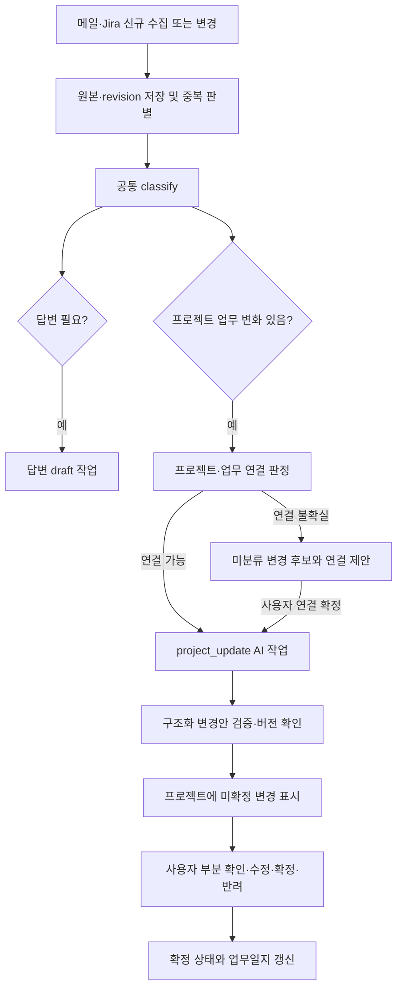

# 프로젝트 중심 업무일지 및 자동 AI 업데이트 기능 계획

작성일: 2026-11-14 · 상태: 구현 전 계획

2026-11-14 구현 반영: 0.4의 실제 동작·검증·구체화한 범위는 [프로젝트 업무일지 사용 안내](project-worklog.md)를 따른다. 아래는 원래 계획을 보존한 것이다. 외부 파일의 실시간 동기화·3-way 자동 병합은 원안과 같이 후속 범위다. 과거 이력 재구성은 프로젝트와 수집 기간을 명시해 요청한다.

## 1. 목표와 확정 방향

업무일지를 프로젝트의 현재 상황과 진행 과정을 관리하는 중심 문서로 변경한다. 메일·Jira의 자동 분류 후 답변이 필요하면 답변 초안을 생성하듯, 업무 변화가 있으면 프로젝트 업데이트 AI를 자동 실행한다.

AI가 추가·수정한 내용은 프로젝트 화면에 즉시 **미확정 변경**으로 표시한다. 사용자가 확인하기 전에는 확정 정보로 승격하지 않는다. 자동화는 업데이트 생성까지 수행하고, 사용자는 변경된 부분을 확인·수정·확정·반려한다. 매번 AI 실행이나 문서 수정 전에 승인을 요구하지 않는다.

핵심 요구사항:

- 프로젝트 아래에서 개요, 진행 항목, 이슈, 결정, 수행 기록, 다음 액션을 함께 관리한다.
- 메일·Jira의 TODO, 결정, 일정 변경, 진행 상황, 수행 보고, 회신 대기 등을 자동 감지한다.
- 답변 필요 여부와 프로젝트 업데이트 필요 여부는 독립적으로 판단한다.
- AI 변경은 부분별 표시와 변경 전후 비교, 출처 확인을 제공한다.
- 사람이 확정한 내용과 직접 수정한 내용을 재실행으로 덮어쓰지 않는다.
- 작은 프로젝트는 `index.md`만으로 운영할 수 있다.
- 기존 수집·분류·초안·작업 큐·원본·이력 기능을 확장한다.

## 2. 현재 구현과 변경 지점

아래 내용은 계획 작성 시 저장소 코드를 확인한 결과다. 향후 기능을 이미 구현한 것으로 해석하지 않는다.

| 현재 구현 | 변경할 내용 |
| --- | --- |
| `projects`는 ID와 고유 이름을 보유 | JOB 코드, 개요, 담당자, 상태, 시작일, 버전 등 추가 |
| `inquiry_projects`는 문의당 하나의 프로젝트 연결 | 문의의 기본 프로젝트와 업무 항목별 연결을 구분 |
| `activities`는 수행 제안·수행 기록 중심 | 프로젝트 전체 기록 중 수행 기록 역할로 유지 |
| 분류 결과는 답변 필요, 할 일, 수행, 대기를 표현 | 프로젝트 변경 여부와 결정·일정·진행 변화 등 확장 |
| classify 완료 후 조건에 따라 draft 작업 등록 | project_update 작업을 독립 분기로 추가 |
| worker는 classify와 나머지 작업을 분기 | 작업 종류별 명시적 dispatch로 변경해 새 작업을 draft로 오처리하지 않도록 함 |
| 프로젝트 화면은 연결 문의·할 일·수행 목록 | 프로젝트 개요와 업무일지, 미확정 변경 검토를 중심으로 재구성 |
| 날짜별 Markdown 수행 내보내기, 파일 단건 가져오기 | JOB 폴더 내보내기와 기존 프로젝트 폴더 가져오기 추가 |

주요 관련 파일: `src/mail_jira_assistant/contracts.py`, `service.py`, `storage.py`, `worklog.py`, `worklog_web.py`, `ai.py`, `settings.py`, `operations.py`, `process_worker.py` 및 관련 프롬프트·테스트. 실제 구현 시 호출부와 설정 전달 경로를 함께 확인한다.

## 3. 자동 처리 흐름



### 3.1 분류와 작업 등록

1. 기존과 같이 수집한 원문과 revision을 보존한다.
2. 공통 분류가 답변 필요 여부와 프로젝트 업데이트 필요 여부를 함께 반환한다. 모든 원문에 별도의 프로젝트 판단 AI를 중복 호출하지 않는다.
3. 유효한 최신 분류 결과 저장과 후속 작업 등록을 하나의 트랜잭션에서 처리한다. 등록 누락은 재조회로 복구한다.
4. 답변 필요이면 기존 `draft`, 업무 변화가 있으면 `project_update`를 각각 등록한다. 둘 다 필요하거나 하나만 필요할 수 있다.
5. 프로젝트 업데이트는 수신·발신 모두 대상이다. 발신 메일의 결정·수행 보고도 기록하되, “검토하겠습니다” 같은 약속은 수행 완료로 해석하지 않는다.
6. 광고·서명·반복 인용·단순 알림은 업무 변화가 없으면 제외한다. 규칙 분류에서도 “답변 불필요”를 “업무 변화 없음”으로 일괄 치환하지 않는다.
7. 분류 결과가 불명확하면 변화 가능 여부를 `unknown`으로 두고 연결된 프로젝트에는 업데이트 AI를 실행해 `no_change` 여부까지 판단하게 한다. 실행이 실패한 경우는 변경 없음으로 처리하지 않는다.
8. 최초 이력 적재는 기존 history-only 원칙을 유지한다. 과거 전체에 자동 업데이트를 만들지 않고 사용자가 프로젝트·기간을 지정해 요청할 수 있게 한다.

기존 `automatic_drafts`와 별도로 `automatic_project_updates` 설정을 둔다. 자동 업데이트를 꺼도 수집·분류는 유지하고 수동 업데이트 요청을 제공한다. AI 실행 환경·인증 활성화는 기존 설정을 따른다.

### 3.2 프로젝트·업무 연결

연결 우선순위는 사용자 확정 연결 → 이미 연결된 Jira/대화 → JOB 코드·등록 규칙 → AI 의미 기반 후보 순서다. 확정된 연결은 자동 변경하지 않는다. 대화 안에 다른 업무가 추가되면 새 업무 항목이나 다른 프로젝트의 연결 후보를 제안한다.

- WorkTrail 프로젝트와 Jira 프로젝트는 별개다. 하나의 JOB에 여러 Jira 이슈·프로젝트 키를 연결할 수 있다.
- 메일 한 통이 여러 업무에 영향을 줄 수 있으므로 변경 항목별로 대상 프로젝트·업무를 지정한다.
- 같은 원문을 여러 프로젝트가 참조할 수 있지만, 같은 수행 기록의 이중 집계는 금지한다.
- 연결 불확실 시 원문과 추출한 변경 후보를 보존하고 수신함에서 연결을 요청한다. 임의의 프로젝트에 반영하지 않는다.
- 적절한 프로젝트가 없으면 새 JOB 생성 후보를 제시한다. 사용자 확정 전에 정식 JOB 번호나 폴더를 만들지 않는다.
- 연결 확정 후 해당 revision으로 업데이트 작업을 자동 등록한다.

## 4. 프로젝트와 업무일지의 구조

```text
JOB-006/
├─ index.md
├─ issues/                 # 상세 관리가 필요할 때 생성
│  └─ ISSUE-001.md
└─ assets/                 # 첨부가 생기면 생성
```

프로젝트는 업무 항목을 가진다. 업무 항목은 메일이나 Jira가 없어도 만들 수 있으며, 하나의 업무에 여러 대화·Jira·첨부를 연결할 수 있다. 단순한 업무는 index의 진행 항목으로 유지하고 경과·결정·첨부가 늘어날 때 상세 이슈 문서로 분리한다. Jira 이슈마다 로컬 문서를 강제 생성하지 않는다.

### 4.1 index.md 템플릿

```markdown
# JOB-006 SmartIO Maintenance

## 개요
- 목적:
- 담당자:
- 상태:
- 시작일:

## 현재 진행 항목
| 구분 | 상태 | 다음 작업 | 문서 |
| --- | --- | --- | --- |

## 주요 이슈

## 주요 결정

## 최근 업데이트

## 다음 액션
```

| 구역 | AI 업데이트 대상 |
| --- | --- |
| 개요 | 목적·담당자·상태·시작일의 명시적 변경 제안 |
| 현재 진행 항목 | 업무 추가, 상태 변경, 다음 작업, 상세 문서 연결 |
| 주요 이슈 | 새 문제·제약·위험·미확인 조건과 해소 여부 |
| 주요 결정 | 결정 내용, 결정자·일자(근거가 있을 때), 관련 근거 |
| 최근 업데이트 | 의미 있는 진행 변화와 수행 내용의 요약 |
| 다음 액션 | TODO, 담당자, 기한, 상대 회신 대기, 선행 조건 |

메일 수신 건수를 업무 진행으로 기록하지 않는다. 새 사실이 없는 반복 인용은 갱신 대상에서 제외한다. 원문 작성일·수집일·결정일·실제 수행일은 구분하며 모르는 날짜는 추정 확정하지 않는다.

## 5. AI 변경과 사용자 확인 방식

### 5.1 확정 내용 위에 미확정 변경을 표시

프로젝트에는 확정 상태와 미확정 변경안을 별도로 저장한다. 화면은 둘을 함께 보여주되 확정 정보와 AI 제안이 명확하게 구분되도록 한다.

- 추가: 해당 항목에 `AI 추가 · 미확정` 배지와 표시를 제공한다.
- 수정: 기존 확정값과 제안값을 비교할 수 있게 표시한다.
- 삭제·완료·취소: 기존 항목을 유지하면서 변경 제안을 표시한다.
- 프로젝트 상단에 미확정 변경 개수와 검토 진입점을 제공한다.
- 색상 외에도 텍스트·아이콘으로 상태를 표시한다.
- 각 변경에서 원문·댓글·첨부 위치와 생성 시각을 확인할 수 있다.

예시:

```text
현재 진행 항목
통신 오류 분석
  확정 상태: 분석 중
  AI 변경 제안: 고객 확인 대기       [미확정]
  AI 다음 액션: 고객 시험 결과 확인 [미확정]
  근거: 보낸 메일 / Jira 댓글
  [확정] [수정 후 확정] [반려] [변경 비교]
```

미확정 TODO도 프로젝트와 오늘 화면의 “AI 제안” 영역에서 바로 확인할 수 있다. 확정 할 일 수, 완료율, 확정 수행 건수에는 포함하지 않는다. AI가 인식한 수행 보고를 확인하더라도 수행자·실제 수행일 검증 등 기존 수행 확정 조건을 만족해야 실적으로 집계한다.

### 5.2 검토 상태와 최신성 분리

변경 항목의 검토 상태는 `pending`, `confirmed`, `rejected`, `superseded`로 관리한다. 생성 작업의 pending/running/failed 상태와 혼동하지 않도록 화면에는 별도 명칭을 사용한다.

최신성은 `current`, `stale`, `conflict`로 별도 관리한다. confirmed/rejected 변경도 당시 판단과 근거를 보존한다.

- 사용자는 항목별 또는 선택한 변경 묶음별로 확정·반려할 수 있다.
- 수정 후 확정 시 AI 원안, 사람 수정본, 확정자를 함께 보존한다.
- 여러 항목이 하나의 변경을 구성하면 의존 관계를 표시한다. 예를 들어 새 업무 생성과 그 업무의 TODO는 함께 적용하거나 유효한 순서로 적용한다.
- 묶음 확정은 서버에서 버전을 재확인하고 원자적으로 적용한다. 일부만 실패한 상태를 숨기지 않는다.
- 새로운 원문·사용자 편집으로 근거 또는 대상이 바뀌면 stale/conflict로 표시하고 재검토한다. 오래된 변경을 그대로 일괄 확정하지 않는다.
- 확정된 결정이 나중에 바뀌면 새 변경 이력으로 남긴다. 기존 결정을 조용히 지우지 않는다.
- 같은 원문·같은 변경의 반려 결과는 자동 재실행으로 다시 띄우지 않는다. 새 근거나 명시적 재생성 요청은 구분한다.

### 5.3 미확정 변경이 누적되는 경우

AI 입력에는 확정 상태와 기존 미확정 변경을 분리해서 제공한다. 이전 미확정 제안을 확정 사실로 인용하지 못하게 한다.

- 같은 업무의 미확정 항목을 후속 변경이 보완하면 기존 제안과 연결한다.
- 같은 필드를 대체하는 새 제안은 이전 제안을 `superseded`로 연결하고 이전 이력은 보존한다.
- 서로 양립할 수 없는 제안은 conflict로 표시하며 최신 메일이라는 이유만으로 승자를 정하지 않는다.
- 서로 다른 필드의 독립 변경은 함께 유지한다.
- 확정·반려 후 의존하는 미확정 변경은 최신성 재평가 또는 재생성 대상으로 전환한다.

## 6. AI 입출력 계약

### 6.1 공통 classify 확장

기존 답변·수행·할 일 판단을 유지하면서 다음 구조를 추가한다. 구체적인 필드명은 구현 시 계약 문서와 함께 고정한다.

| 필드 | 의미 |
| --- | --- |
| `project_update_needed` | yes / no / unknown |
| `update_kinds` | todo, decision, progress, schedule, performed, waiting, issue, project_metadata |
| `project_hints` | JOB 코드·Jira 키·명시 제품명 등 연결 단서 |
| `update_evidence` | 변경 판단의 원문 및 위치 참조 |

계약 버전을 올리고 기존 저장 분류는 보존한다. 구버전 분류의 신규 필드 부재를 자동으로 `no` 처리하지 않는다. 활성 처리에 필요한 경우 재분류하며 과거 baseline은 자동 재처리하지 않는다.

### 6.2 프로젝트 업데이트 AI 입력

- 이번 변경 원문과 source/revision ID, 수신·발신 방향, 변경 전후 차이.
- 필요한 범위의 이전 대화·Jira 댓글·첨부 추출 결과와 누락 한계.
- 대상 프로젝트·업무 ID와 버전, 확정된 개요·진행 항목·결정·다음 액션.
- 관련된 미확정 변경과 반려 이력. 확정 정보와 구분한 별도 필드로 제공.
- 사용자 확정 연결, 수동 수정, 기존 할 일·수행 기록의 안정적인 ID.
- 허용된 근거 목록, 입력 분량 제한, 해석하지 못한 이미지·문서 정보.

전체 프로젝트 문서를 매번 무제한 입력하지 않는다. 관련 업무와 최근 변경을 우선하고 누락 범위를 명시한다.

### 6.3 AI 출력 및 검증

AI는 파일 전체 대신 구조화한 변경 항목 목록 또는 `no_change` 결과를 반환한다.

| 필드 | 의미 |
| --- | --- |
| 대상 | project_id, work_item_id, section, 안정적인 항목 ID |
| 연산 | 추가, 수정, 삭제 제안 |
| 변경 | 기준 버전·기존 값·제안 값 |
| 의미 | TODO·결정·일정·상태·수행 보고 등의 종류 |
| 근거 | source_id, revision_id, segment/댓글/첨부 위치와 발췌 |
| 설명 | 변경 이유와 불확실성 |
| 의존성 | 함께 처리해야 하는 변경 항목 |

프로그램은 대상의 존재·소속, 허용 연산, 근거 위치·발췌 일치, 날짜 형식, 기준 버전, 중복·의존 관계를 검증한다. 원문·첨부 안의 명령은 분석 대상 데이터로 취급하며 실행 지시로 따르지 않는다. 검증 실패는 확정 내용에 영향을 주지 않고 실패 원인을 기록한다. 형식 검증만으로 의미 정확성이 보장되는 것은 아니므로 사람 확인을 유지한다.

## 7. 데이터 모델과 처리 안정성

다음은 논리적 모델이다. 테이블명·분할은 기존 구조와 실제 migration 설계에서 확정한다.

| 모델 | 책임 |
| --- | --- |
| projects 확장 | 안정적인 ID/JOB 코드, 개요·상태·담당자·시작일·버전 |
| project_work_items | 프로젝트 소속 업무·이슈, 상태, 상세 문서 여부 |
| project_source_links | 프로젝트·업무와 메일/Jira 연결, 사용자/규칙/AI 구분, 연결 확정 여부 |
| project_entries | 확정된 TODO·결정·업데이트 등 구조화 항목과 버전 |
| project_update_runs | 입력 revision·context hash·모델/프롬프트 버전·생성 결과 |
| project_change_items | 대상·연산·기존/제안 값·검토 상태·최신성·의존 관계 |
| project_change_evidence | 변경별 원문·댓글·첨부 revision 참조 |
| project_review_history | 확정·수정·반려·수동 편집 이력 |

기존 actions/activities와 의미가 겹치는 TODO·수행은 안정적인 참조로 연결한다. 같은 할 일을 별도 목록에 이중 생성하지 않는다. 공통 분류의 수행 제안도 project_update가 새 수행 기록을 다시 생성하지 않고 기존 activity에 연결한다. 신규 프로젝트 업무의 TODO 역시 기존 action과 대응시킨다.

안정성 요구:

- 자동 작업은 문의 ID + 입력 revision + 작업 종류 + 대상 프로젝트 기준으로 중복 등록을 막는다. 명시적 재생성은 별도 request ID와 버전을 가진다.
- 변경의 중복은 AI 문장 문자열만으로 판별하지 않는다. 동일 Jira 사건의 알림 메일·API 수집은 가능한 경우 서버/이슈/댓글 또는 event ID로 묶는다.
- 의미만 유사한 서로 다른 근거는 자동 병합하지 않고 중복 후보로 표시한다. 같은 이슈의 별도 댓글은 별도 변경으로 처리할 수 있다.
- 입력 원문 또는 프로젝트 버전이 실행 중 바뀌면 stale/conflict로 저장하거나 폐기 후 재등록한다. 최신 확정 내용을 덮어쓰지 않는다.
- 기존 queue의 lease·attempt token·timeout·재시도 정책을 재사용한다. 작업 성공 처리와 결과 저장은 같은 트랜잭션에서 처리한다.
- draft와 project_update의 실패는 독립적이다. 한쪽 실패가 다른 결과와 수집을 되돌리지 않는다.
- 수동 연결 변경 시 기존 제안을 자동 이동하지 않는다. 재검토 표시 후 올바른 대상으로 새 작업을 요청한다.
- 새 테이블·연결·이력·문서를 백업/복원 대상에 포함한다.

## 8. UI 변경

### 8.1 프로젝트 상세

프로젝트 상단에 개요·상태·미확정 변경 수를 표시하고 다음 기능을 제공한다.

- index 템플릿 구역별 확정 내용과 AI 변경 표시.
- 업무별 TODO·회신 대기·수행·결정·진행 이력 조회.
- 변경 전후 비교, 원문 위치 열기, 부분 확정·수정 후 확정·반려.
- 관련 메일·Jira와 첨부·추출 결과 확인.
- 마지막 업데이트 처리 상태, 실패·재시도·명시적 재생성.
- 직접 업무 추가·프로젝트 편집. 수동 입력은 사람 작성으로 기록.

### 8.2 수신함·오늘·업무일지

| 화면 | 변경 |
| --- | --- |
| 수신함/문의 상세 | 연결 프로젝트·업무, 프로젝트 업데이트 대기/성공/실패/변경 없음 표시, 미분류 연결 검토 |
| 오늘 | 확정 할 일·대기와 AI 미확정 TODO·일정 변경을 구분, 프로젝트로 이동 |
| 프로젝트 목록 | JOB 코드·상태·다음 액션·미확정 변경 수 |
| 날짜별 업무일지 | 각 프로젝트의 확정 수행 기록을 모아 보는 조회·보고 화면으로 유지 |
| 답변 초안 | 기존 검토 흐름 유지, 같은 문의의 프로젝트 변경으로 이동하는 링크 |

초안 확정과 프로젝트 변경 확정은 독립적이다. 한쪽을 확인했다고 다른 쪽이 자동 확정되지 않는다. 메일 발송·Jira 댓글 게시·상태 쓰기는 이번 범위에 포함하지 않는다.

## 9. Markdown 저장·기존 자료 이관

첫 구현의 기준 데이터는 DB로 두고, 프로젝트 구조의 Markdown을 내보낸다. 기존 에이전트가 폴더를 직접 수정하던 방식과 혼용하면서 발생할 수 있는 양방향 덮어쓰기를 피하기 위해 파일 역할을 명시한다.

- 기본 내보내기는 확정 내용과 별도로 구분한 미확정 변경 목록을 포함한다. 미확정 항목에는 상태·변경 ID·근거를 텍스트로 남긴다.
- 확정본만 내보내는 옵션을 제공한다. 확정본에는 미확정 제안의 결과값이 섞이지 않아야 한다.
- 수동 작성 영역과 생성 영역을 구분하고, 재내보내기는 사용자 메모를 보존한다.
- 외부에서 생성 영역을 수정했다면 해시 비교로 충돌을 감지하고 덮어쓰기를 중단한다. 직접 수정 내용을 가져오는 검토 경로를 제공한다.
- 기존 JOB 폴더 가져오기는 index·issues·assets와 원본 경로·해시를 보존한다. 개요·결정·TODO 문서를 수행 기록 하나로 변환하지 않는다.
- 기존 Markdown은 우선 “가져온 문서”로 보존한다. AI가 구조화한 항목은 확인 대상으로 제공하고 일괄 확정 선택을 허용한다.
- 초기 버전은 외부 Markdown의 실시간 양방향 자동 동기화를 제공하지 않는다. 명시적 가져오기/갱신으로 처리한다.
- 폴더명은 검증된 JOB 코드로 생성하고 임의 경로를 AI 출력에서 받지 않는다. 첨부는 원본 blob 참조와 체크섬을 유지하며 이름 충돌을 처리한다.
- 앱이 생성한 프로젝트 Markdown을 메일·지식 수집 대상으로 재입력해 자기 내용을 새 업무로 만드는 순환을 차단한다.

외부 편집기/OpenCode의 상시 직접 편집까지 유지하려면 후속으로 파일 변경 감지·항목 ID 매핑·3-way 비교를 추가한다. 이 기능 없이 양방향 동기화를 지원한다고 표기하지 않는다.

## 10. 역할 구성

`worklog-manager`에 해당하는 프로젝트 업데이트 AI가 프로젝트 맥락을 바탕으로 변경안을 생성한다. 기존 공통 classify가 실행 필요성을 판단하고, 프로그램이 검증·저장·검토 상태를 관리한다. 초기 구현은 기존 runner에 역할별 프롬프트/호출을 추가하며 다중 에이전트 상주 구성을 요구하지 않는다.

Office 분석은 기존 추출 결과와 위치를 사용한다. 이미지 의미 해석은 현재 미지원이므로, 필요한 변경을 “이미지 확인 필요”로 표시하고 수치·결론을 추측하지 않는다. `office-analyzer`/`image-analyzer`의 독립 역할 확장은 교체 가능한 전처리 경계로 두고 이번 기능의 필수 선행 조건으로 만들지 않는다.

## 11. 구현 단계와 완료 기준

| 단계 | 작업 | 완료 기준 |
| --- | --- | --- |
| P1: 프로젝트 기준 정립 | 프로젝트 확장, 업무 항목, 변경·근거·검토 모델, migration·백업 | 기존 원문·초안·기록을 보존하고 프로젝트 없는 기존 기록도 유실 없이 조회 가능 |
| P2: 분류·작업 연결 | classify 계약/규칙 확장, 작업별 dispatch, 독립 자동 설정, 큐 등록·복구 | 답변만/업데이트만/둘 다/둘 다 없음이 올바르게 실행됨 |
| P3: 업데이트 AI | 프로젝트 context, 구조화 출력, 근거·버전 검증, 중복·no_change 처리 | 합성 메일·Jira에서 TODO·결정·일정·진행 변경이 미확정 항목으로 생성됨 |
| P4: 검토 UI | 프로젝트 상세, 변경 표시·비교·부분 확정·수정·반려, 수신함/오늘 연결 | AI 변경을 즉시 확인할 수 있고 확정 전 집계·기존 확정값에 영향을 주지 않음 |
| P5: 연속 변경·복구 | superseded/conflict, 동시 편집·재시도·연결 변경·작업 실패 | 후속 원문·사용자 수정·worker 종료에도 덮어쓰기와 중복 확정이 없음 |
| P6: 폴더·이관 | 프로젝트 Markdown 출력, JOB 폴더 가져오기, 메모/해시 충돌 보존 | index만 있는 프로젝트 및 issues/assets 포함 프로젝트를 모두 처리 |
| P7: 검증·배포 | 실제 모델 합성 평가, 기존 회귀, Windows 패키지/재기동, 문서 갱신 | 검증 결과·오류·현장 미검증 범위를 기록하고 사용 가능한 앱으로 전달 |

최소 수직 구현은 “프로젝트 하나 + 메일의 TODO/결정 → 자동 분류 → project_update → 프로젝트 미확정 표시 → 부분 확정”으로 잡는다. 이후 Jira·다중 업무·연속 변경을 같은 경로에 확장한다. 최소 구현만으로 전체 완료를 선언하지 않는다.

## 12. 필수 검증 시나리오

| ID | 입력·상황 | 기대 결과 |
| --- | --- | --- |
| U01 | 답변 불필요지만 신규 TODO 포함 | draft 없이 project_update 실행 |
| U02 | 답변 필요지만 업무 변화 없음 | draft만 실행 |
| U03 | 답변과 결정·TODO가 함께 있음 | 두 작업이 독립 실행 |
| U04 | 보낸 메일 “검토하겠습니다” | TODO/약속 제안, 수행 완료 아님 |
| U05 | 보낸 메일 “시험 완료, 결과 전달” | 수행 제안 및 다음 상태, 확정 전 실적 제외 |
| U06 | 결정 변경 또는 일정 연기 | 기존값/제안값과 각각의 근거 표시 |
| U07 | 같은 Jira 댓글의 알림 메일+API | 동일 사건의 중복 업데이트 방지 |
| U08 | Jira의 서로 다른 새 댓글 | 의미 있는 각 변경 보존 |
| U09 | 한 메일에 두 프로젝트 업무 | 변경별 분리 연결 또는 연결 검토 |
| U10 | 연결 불명확·신규 프로젝트 후보 | 임의 JOB 생성/반영 없이 후보 보존 |
| U11 | 사람 확정·편집 중 AI 결과 도착 | 확정 내용 유지, stale/conflict 처리 |
| U12 | 미확정 TODO 뒤에 일정 변경 수신 | 제안 연결·대체 이력, 미확정 내용을 확정 사실로 사용하지 않음 |
| U13 | 부분 확정·수정 후 확정·반려 | 선택 항목과 의존성만 처리, AI 원안·사람 판단 보존 |
| U14 | 같은 원문 재수집·재시도·재시작 | 작업·변경·할 일·수행 중복 생성 없음 |
| U15 | project_update timeout/잘못된 JSON/근거 오류 | 실패 표시·재시도 가능, draft/확정 내용 보존 |
| U16 | history-only 최초 수집 | 과거 전체에 자동 업데이트 없음 |
| U17 | 반려 후 같은 입력 재실행 | 반려 변경을 새 제안으로 반복 생성하지 않음 |
| U18 | Jira Done, 내 작업·고객 확인 미완료 | 프로젝트·내 수행을 임의 완료하지 않음 |
| U19 | 생성 문서 재수집·파일 직접 편집 | 순환 처리 차단, 사용자 편집 충돌 보존 |
| U20 | JOB index 단독/하위 문서·첨부 포함 이관 | 구조·원본 보존, 결정/TODO를 수행으로 오인하지 않음 |
| U21 | 묶음 확정 중 버전 충돌·의존 항목 누락 | 원자적 실패 또는 명시적 유효 부분 처리, 숨은 부분 적용 없음 |
| U22 | 백업/새 경로 복원·Windows 재기동 | 확정/미확정·근거·검토 이력·연결 유지 |
| U23 | 분류 unknown·프로젝트 AI no_change | 필요한 추가 판단 수행, 변경 없음과 실패 구분 |
| U24 | 미해석 이미지·불완전 Jira 응답 | 한계 표시, 수치 추측·거짓 삭제 제안 방지 |

결정적 저장·연결·집계·복구 동작은 fake runner로 자동 검증한다. 실제 모델 평가는 별도로 TODO·결정 추출 정확성, 프로젝트 연결, 변경 최소성, 근거 적합성, 무변경 판정, 검토 부담, 실행 시간·입력 분량을 기록한다. 합성 검증을 사내 실제 메일/Jira 정확도 보장으로 표기하지 않는다.

## 13. 완료 정의와 후속 문서

완료 시 사용자는 메일/Jira를 수집한 뒤 별도의 업데이트 지시 없이 프로젝트의 변경 내용을 확인할 수 있어야 한다. AI가 바꾼 부분은 미확정으로 식별되고, 부분 확정 후에만 확정 업무 상태·집계에 반영되어야 한다. 재수집·후속 변경·동시 편집·실패·재기동에도 사람의 수정과 판단을 보존해야 한다.

구현 시 `docs/contracts.md`에 분류/업데이트 계약, `docs/decisions.md`에 확정/미확정 및 DB/Markdown 선택, `docs/progress.md`에 실제 검증 결과, `README.md`와 운영 안내에 설정·검토·이관 방법을 갱신한다. 이 문서는 구현 계획이며 현재 기능 완료 기록을 대체하지 않는다.
